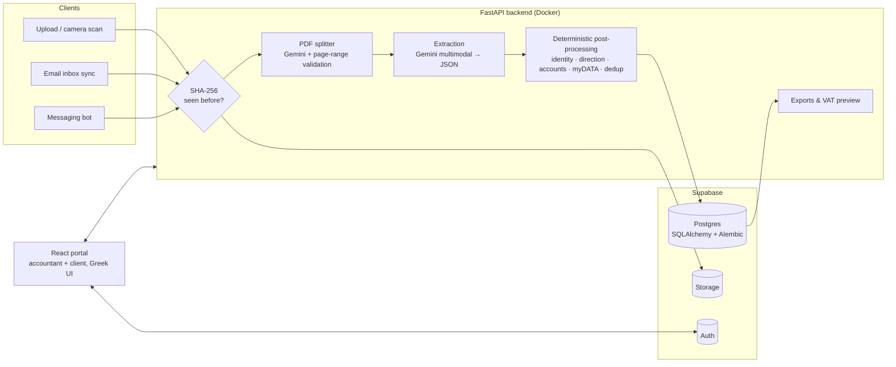

# LLM document extraction for bookkeeping

[](https://github.com/thanzap/llm-document-extraction/actions/workflows/ci.yml)


A document-intelligence engine that turns photos and PDFs of invoices and receipts into validated,
de-duplicated bookkeeping entries, ready to import into accounting software. Documents are read by a multimodal
LLM (Gemini); everything the books depend on is checked by deterministic code.

This repository contains the core engine with its tests, extracted from a larger private application (a portal
where clients submit documents and accountants review them), plus the architecture and the design decisions.

---

## The problem

An accounting office receives hundreds of documents a month per client: crumpled receipts photographed on
a phone, 30-page PDFs with a whole month of invoices scanned in one go, the same invoice sent twice, once as a
photo and once as a PDF. Each one is typed into the accounting software by hand: counterparty, VAT number,
per-rate VAT breakdown, chart-of-accounts code, and the myDATA classification required by the tax authority.

## What it does

| | |
|---|---|
| 📄 **Reads any document** | One multimodal Gemini call per document, with no separate OCR step. Greek and English, photos, PDFs, Office files. |
| ✂️ **Splits batch scans** | A PDF holding many receipts is split into one document per receipt. A multi-page invoice stays together. |
| 🧭 **Knows who is who** | Expense or sale? Which party is the counterparty? Settled deterministically from VAT numbers when possible. |
| 🧾 **Books it** | Per-rate VAT lines, chart-of-accounts code and official myDATA category/E3 codes, all validated against the allowed lists. |
| 🔁 **Never double-counts** | Same file → SHA-256. Same invoice, different file → ΜΑΡΚ, or VAT + number + date (Greek/Latin look-alike letters unified). |
| 📊 **VAT preview** | Output − input VAT per month/quarter, with the next Φ2 return deadline. |
| 📤 **Exports** | Accounting-software bulk-import workbook: one line per VAT rate, comma decimals, counterparties and accounts sheets. |
| 📬 **Collects automatically** | Email-inbox sync (OAuth), a messaging-bot channel with HMAC-signed callbacks, and AI parsing of bank statements matched to invoices. |

## Architecture



- **Backend:** FastAPI, SQLAlchemy, Alembic (17 migrations), background processing tasks, Docker
- **AI:** Google Gemini 2.5 Flash via `google-genai`, JSON-mode responses, injected model client for testing
- **Data/Auth/Storage:** Supabase (Postgres, Auth with invite flow, private storage bucket); all data access
  goes through the API with the service role, and the browser only holds the anon key
- **Frontend:** React 18, React Router, Recharts dashboards, full Greek translation
- **Integrations:** Gmail API (OAuth), messaging bot API (HMAC-signed webhooks), bank statements (Excel/CSV/PDF)

## Design decisions worth reading

**1. The LLM proposes, deterministic code decides.**
[`extraction.post_process`](invoice_core/extraction.py) treats the model's JSON as a draft. If the issuer's VAT
equals the client's own VAT, the document is a sale, whatever the model said
([`identity.py`](invoice_core/identity.py)). An account code is accepted only if it exists **and** sits on the
right side (expense vs income); otherwise keyword rules take over and a warning is recorded. myDATA codes that
aren't in the official lists are replaced with the safe default
([`classification.py`](invoice_core/classification.py)).

**2. Validate the model's structure before acting on it.**
The batch-scan splitter ([`pdf_split.py`](invoice_core/pdf_split.py)) asks Gemini for page ranges, then checks
that every page is covered exactly once (documents + skipped blank pages). Any inconsistency means *no split*: the
file is handled as one document, exactly as before. A wrong answer degrades to the old behaviour instead of
corrupting data.

**3. Cheapest check first.**
Duplicate detection ([`dedup.py`](invoice_core/dedup.py)) hashes bytes *before* storage or any model call, so a
re-sent file costs nothing. Only new bytes reach the more expensive invoice-level match.

**4. Money is `Decimal`, and messy input is normalised once.**
[`amounts.py`](invoice_core/amounts.py) accepts every shape the model has ever returned (`'1.234,56 €'`,
`{"24%": "3,60"}`, `"24%:3.25"`, structured lines) and produces one canonical form. A 0% rate is a real
(VAT-exempt) rate, not "missing". Unparseable dates are kept verbatim for human review instead of being dropped.

**5. Make the model swappable.**
Every model call is injected (`ask`, `ask_json`), so the whole pipeline is unit-tested without network access
or API keys.

## Run the tests

```bash
python -m venv .venv && source .venv/bin/activate
pip install -e ".[dev]"
pytest -q        # 39 tests, no API key needed
ruff check .
```

To try extraction against a real document:

```python
from functools import partial
from google import genai
from invoice_core.extraction import Account, Owner, call_gemini, extract

ask = partial(call_gemini, genai.Client(), "gemini-2.5-flash")   # needs GEMINI_API_KEY
chart = [Account("64.08", "Έξοδα τηλεπικοινωνιών", "expense"), Account("73.00", "Έσοδα υπηρεσιών", "income")]
inv = extract(open("receipt.pdf", "rb").read(), "application/pdf", Owner("My Company", "EL123456789"), chart, ask)
print(inv)
```

## Repository layout

```
invoice_core/
  extraction.py      prompt, Gemini call, deterministic post-processing pipeline
  identity.py        counterparty vs client, expense vs income
  dedup.py           file hash + invoice-level duplicate matching
  pdf_split.py       batch-scan splitting with validated page ranges
  amounts.py         Decimal money, dates, per-rate VAT line normalisation
  classification.py  official myDATA income/expense categories and E3 codes
  vat.py             VAT period maths, Φ2 deadline, output/input VAT preview
  accounting_export.py  bulk-import .xlsx export for accounting software
tests/               pytest suite (runs in CI on Python 3.11–3.13)
```

---

Built by **Thanasis Zapatetas**. Shared for portfolio review; see [LICENSE](LICENSE).
